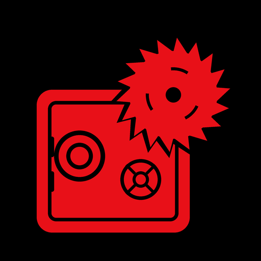

<p align="center">
  
</p>

# PKG Splitter + PKG Vault

Move a **big PS4 game PKG** (for example 40 GB) onto a PS4 using a **small USB drive** (for example 8 GB), one piece at a time.

This project has **two tools that work together**:

| Tool | Where it runs | What it does |
|------|---------------|--------------|
| **PKG Splitter** (web) | In your browser, on your PC | Cuts a big PKG into smaller parts. It only cuts. It does **not** join anything. |
| **PKG Vault** (PS4 app) | On your PS4, with the PS4 controller | Saves the parts from the USB to the PS4 drive, joins them **inside the PS4**, and makes the final PKG ready to install. |

> Made by **OnyxSoul-1** · built with Claude and DeepSeek

---

## How it works

```
 PC (web tool)                 USB drive                  PS4 (PKG Vault app)
 ─────────────                 ─────────                  ───────────────────
 big game.pkg  ──split──►  game.pkg.0   ──plug in──►  copy to PS4 drive
                           (then game.pkg.1, .2 ...)   (repeat for every part)
                                                              │
                                                         press Join
                                                              ▼
                                                  /data/pkg_vault/FULL_GAME.pkg
                                                              │
                                                    install with Package Installer
```

---

## What you need

- A **jailbroken PS4** that can install homebrew PKG files and run homebrew apps (the app was made for a GoldHEN setup).
- A **USB drive**. Use **exFAT**. FAT32 cannot hold files of 4 GiB or bigger.
- A PC or Chromebook with a browser.
- **Free space on the PS4.** While joining, the PS4 holds all the parts **and** the final file, so you need about **2× the game size** free. The install itself needs more space after that.
- The game PKG must be a game **you own**.

---

## Part 1: Split the game (web tool)

1. Open the web tool: **https://onyxsoul-1.github.io/pkg-splitter/**
2. Choose your game PKG file.
3. Split it into parts and save them to your USB drive.
4. Check the part names. They **must end in a plain number**:

   ```
   game.pkg.0
   game.pkg.1
   game.pkg.2
   ...
   ```

   Names like `game.pkg.part1` will **not** sort correctly on the PS4.

5. Put **one part (or a few) on the USB at a time**, if your USB is small.

---

## Part 2: Get the PS4 app (PKG Vault)

### Option A: Download the ready build

1. Open the **Actions** tab of this repo.
2. Click the **latest run with a green check**.
3. Scroll down to **Artifacts** and download **`final-pkg`**.
4. The download is a **ZIP file**. **Unzip it.** Inside is **`final.pkg`**. That is the real PKG.
   (A ZIP renamed to `.pkg` will **not** install.)
5. Rename `final.pkg` if you like (the PS4 does not care about the file name).

### Option B: Build it yourself

1. **Fork** this repo.
2. Make sure these files are in the main folder: `pkg_vault.c`, `icon0.png`.
3. Make sure `.github/workflows/build.yml` is there.
4. Any commit starts the build. Open the **Actions** tab, wait for the green check (1 to 2 minutes), then download **`final-pkg`** as in Option A.

### Install the app on the PS4

Install `final.pkg` the same way you install any homebrew PKG (copy it to a USB drive or the PS4 and use your Package Installer). After that, **PKG Vault** shows on the home screen with a red safe and saw-blade icon.

---

## Part 3: Use PKG Vault

Open **PKG Vault**. You get a menu screen. Use the **PS4 controller**:

| Button | What it does |
|--------|--------------|
| **D-pad Up / Down** | Move in the menu |
| **X** | Select |
| **O** | Exit the app |

### Menu

| Option | What it does |
|--------|--------------|
| **Copy parts from USB** | Copies every part on the USB to the PS4 drive. A progress bar shows the copy. |
| **Join parts into FULL_GAME.pkg** | Joins all saved parts (in number order) into one file. |
| **Delete FULL_GAME.pkg** | Deletes the joined file to free space. |
| **Exit** | Closes the app. |

The right side of the screen shows:

- how many parts are **saved on the PS4** (and their names and sizes),
- whether the **USB** is found and how many parts are waiting,
- whether **FULL_GAME.pkg** exists.

### Step by step

1. Plug in the USB with **part 1**. Open PKG Vault.
2. Wait for **"USB: 1 part(s) waiting"**, choose **Copy parts from USB**, press **X**.
3. Wait for **"Copied 1 part(s) to the PS4"**, then **unplug the USB**.
   Do not unplug while the progress bar is moving.
4. Plug in the next USB (or the same USB with the next part) and **Copy** again.
   The saved parts stay on the PS4 even if you close the app.
5. Repeat until **all parts** are saved. The screen shows **"Saved on PS4: N part(s)"**.
6. Choose **Join parts into FULL_GAME.pkg**, press **X**, and wait for
   **"Join complete! FULL_GAME.pkg is ready."**
7. Press **O** to exit PKG Vault.

### Install the game

1. Open your **Package Installer**.
2. Choose the file **`/data/pkg_vault/FULL_GAME.pkg`**.
3. Let the game install.
4. When it is done, open PKG Vault and choose **Delete FULL_GAME.pkg** to free the space.

---

## Good to know

- **Parts can be copied in any order.** The join always puts them in number order.
- **After a part is copied, it is renamed on the USB** to `game.pkg.0.done`, so it is not copied twice. To copy it again, remove the `.done` ending.
- **One USB can hold several parts.** One Copy press copies all of them.
- **Do not mix two games.** The join uses every saved part.
- **Parts are deleted only after a successful join.** If the join fails (for example, the disk is full), your parts are kept.
- **USB detection:** the app looks at `/mnt/usb0/` to `/mnt/usb7/`.
- **The app does not install the game by itself.** It prepares `FULL_GAME.pkg`, and you install it with your Package Installer. (An experimental auto-install option exists in the code, but it is turned off.)
- **Log file:** the app writes a small log to `/data/pkg_vault_log.txt` on the PS4. If something goes wrong (for example, a black screen), the first lines of this file help find the problem.

---

## Troubleshooting

| Problem | What to try |
|---------|-------------|
| The PS4 says the PKG is invalid | You installed the **ZIP**. Unzip it and use `final.pkg` inside. |
| "USB: not found" | Plug the USB in again, wait a few seconds, use exFAT. |
| "No parts found on the USB" | Part names must contain `.pkg.` and end in a number, like `game.pkg.0`. Names ending in `.done` are ignored. |
| "Copy FAILED" | The PS4 drive may be full, or the USB was removed. Free space and try again. |
| "Join FAILED" | Not enough free space. Your parts are kept. Free space and join again. |
| The Package Installer cannot see `FULL_GAME.pkg` | Make sure it can browse `/data/pkg_vault/`. |
| Black screen when the app opens | Check `/data/pkg_vault_log.txt` and open an issue with its first lines. |

---

## Build details (for developers)

- `pkg_vault.c` is the whole PS4 app (menu, controller, copy, join).
- `icon0.png` is the app icon (512×512). The build uses it automatically if it is in the main folder.
- `.github/workflows/build.yml` builds the PKG on GitHub Actions:
  1. downloads the **OpenOrbis PS4 Toolchain v0.5.4** (`toolchain-llvm-18.tar.gz`),
  2. compiles with `clang-18` and links with `lld`,
  3. makes `eboot.bin` with `create-fself`,
  4. makes `param.sfo`, a GP4 file and the fake PKG with the toolchain's `PkgTool.Core`,
  5. uploads `final.pkg` as an artifact.
- To change the **name shown on the PS4**, edit `TITLE` in `build.yml` and `APP_NAME` in `pkg_vault.c`.
- To change the **credits text** inside the app, edit `CREDITS` in `pkg_vault.c`.
- To try the experimental auto-install, set `EXTRA_CFLAGS: "-DENABLE_APPINST"` in `build.yml`. It may not work.

---

## Credits

- **OnyxSoul-1**: idea, design and testing.
- Built with **Claude** (Anthropic) and **DeepSeek**.
- [OpenOrbis PS4 Toolchain](https://github.com/OpenOrbis/OpenOrbis-PS4-Toolchain) and LibOrbisPkg tools.

## My try
soo the usb is like bug ineed to fix too i add you can use too things the ps4 xpla... idk the name ok and my app, and you use that app to not my i mean that copy the files and but in the pkg s or v.. is big name not tall only the name app on the ps4 and than you but you go to your own and paste the files one by one and than done and than you join and done game do you know my game ??  ((is Ghost of ...))

## Disclaimer

This is homebrew software, made for **personal use with content you own**. It comes **without any warranty**. You use it at your own risk. This project is not made by or connected to Sony.

See the `LICENSE` file for the license.
